<!-- Premium GitHub Profile README for shahbaz1302 -->

<picture>
  <source media="(prefers-color-scheme: dark)" srcset="./dark.svg">
  <source media="(prefers-color-scheme: light)" srcset="./light.svg">
  
</picture>

<h1 align="center">Hi, I'm Mohd Shahbaz Khan 👋</h1>
<h3 align="center">Software Engineer | Full Stack &amp; AI Engineering</h3>

  Recent graduate • Open to full-time opportunities • India

  
  
  
  

---

## 👨‍💻 About Me

- I'm a recent graduate pursuing opportunities to grow as a **Software Engineer**.
- I build full-stack applications, design backend APIs, and integrate AI capabilities into practical products.
- I'm especially interested in **LLM-powered applications, tool calling, and intuitive developer experiences**.
- I value learning by building: **develop on your own**.

## 🧰 Technology Stack

  

  
  
  
  
  

## 🚀 Featured Projects

### [APEX AI Code Editor](https://github.com/shahbaz1302/APEX-AI-Editor)
An AI-powered code editor project focused on bringing AI assistance into the development workflow.
**Live demo:** [apex-ai-editor.vercel.app](https://apex-ai-editor.vercel.app)

### [NEXUS AI](https://github.com/shahbaz1302/Nexus-AI)
An AI application built to explore practical AI-powered experiences.  
**Live demo:** [nexus-ai-red-alpha.vercel.app](https://nexus-ai-red-alpha.vercel.app)

### [WEARIX](https://github.com/shahbaz1302/Wearix)
A full-stack e-commerce application.  
**Live demo:** [wearix-store.vercel.app](https://wearix-store.vercel.app)

## 💼 Experience & Recognition

- **MERN Stack Developer Intern** — GRAStech
- **Google Gen AI Hackathon** — Certificate of participation; powered by Hack2skill

## 📊 GitHub Statistics

  
  

  

## 🐍 GitHub Contributions

  <picture>
    <source media="(prefers-color-scheme: dark)" srcset="https://raw.githubusercontent.com/shahbaz1302/shahbaz1302/output/github-snake-dark.svg">
    <source media="(prefers-color-scheme: light)" srcset="https://raw.githubusercontent.com/shahbaz1302/shahbaz1302/output/github-snake.svg">
    
  </picture>

## 🤝 Connect With Me

  <a href="https://github.com/shahbaz1302">GitHub</a> •
  <a href="https://www.linkedin.com/in/mohd-shahbaz-khannn">LinkedIn</a> •
  <a href="https://shahbazfolio.netlify.app">Portfolio</a> •
  <a href="mailto:khanmohdshahbaz70@gmail.com">Email</a>

<i>Develop on your own. Learn continuously. Build things that matter.</i>

